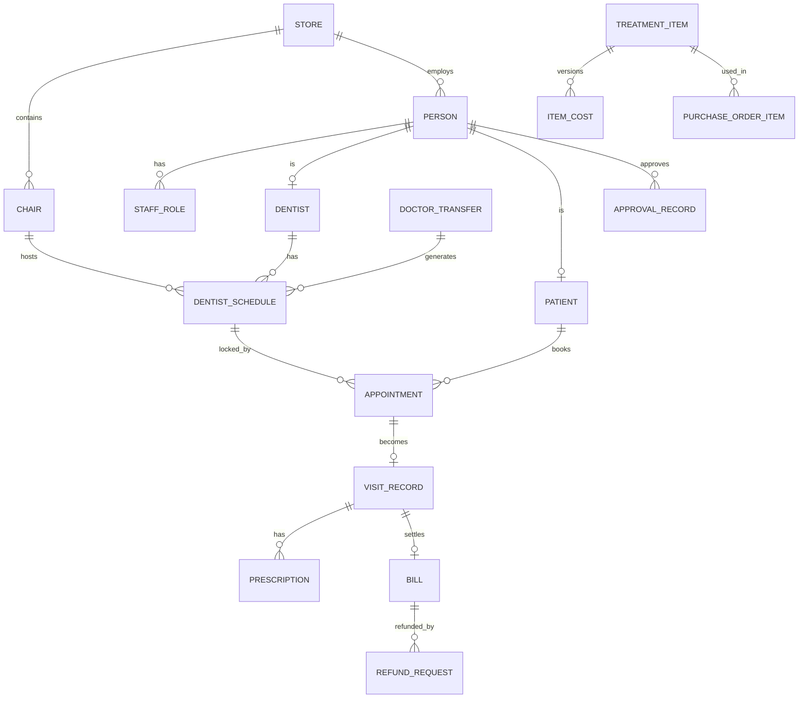

# 信义口腔连锁管理系统 · 数据模型（data-model.md）

> Spec-kit 第 3 阶段产出物。由 `spec.md` 与 `plan.md` 推导，落地为 `src/schema.sql` 的 40 张表。

**版本**：1.1
**日期**：2026-11-24
**状态**：已落地（40 / 40 张表）

---

## 1. 表清单

### 1.1 业务表（26 张）

| 分组 | 表 | 说明 |
|---|---|---|
| 组织与人员 | `store`、`person`、`patient`、`dentist`、`nurse` | 门店、统一人员档案、患者、牙医、护士 |
| 资源与目录 | `chair`、`treatment_item` | 椅位；64 项诊疗项目与参考价 |
| 预约与接诊 | `dentist_schedule`、`appointment`、`visit_record` | 排班号源、预约、就诊记录 |
| 套餐与处方 | `package`、`package_item`、`package_card`、`prescription`、`prescription_item`、`treatment_plan`、`treatment_plan_item` | 套餐定义与卡、处方、分期治疗计划 |
| 收费与随访 | `bill`、`followup_reminder` | 收费单、复诊提醒 |
| 物资采购 | `material`、`stock_movement`、`purchase_order`、`purchase_order_item` | 耗材、库存流水、采购单与明细 |
| 成本绩效 | `item_cost`、`expense`、`doctor_performance` | 项目成本版本、期间费用、医生绩效明细 |

### 1.2 支撑表（8 张）

| 表 | 说明 |
|---|---|
| `staff_role` | 人员—角色多对多，支持一人多角色 |
| `patient_session` | 患者令牌会话 |
| `staff_session` | 员工令牌会话，`active_role` 记录当前身份 |
| `doctor_transfer` | 医生临时借调单，`transfer_id` 回写排班标记来源 |
| `store_manager` | 分院负责人关联 |
| `approval_record` | 统一审批留痕，`biz_type` 含员工注册 / 医生借调 / 退款审批 |
| `sms_message` | 模拟短信留痕（注册、审批结果、改密） |
| `refund_request` | 退款申请，唯一键幂等、额度校验、审批 |

### 1.3 会员与洁牙表（6 张）

| 表 | 说明 |
|---|---|
| `hygienist` | 洁牙师（person 子类），独立执行洗牙/洁牙 |
| `hygiene_schedule` | 洁牙号源：洁牙师＋洁牙椅＋日期＋时段，与 `dentist_schedule` 完全分开 |
| `coupon_template` | 优惠券模板：绑定项目的会员优惠价（如超声波洁牙 68 元，原价 98） |
| `coupon` | 会员持有的券实例，一次性使用，取消预约自动退回 |
| `hygiene_appointment` | 洁牙预约：用券享会员价 / 套餐卡扣次 / 到店支付三选一 |
| `package_order` | 患者端模拟支付购买洁牙次数套餐，支付后生成套餐卡 |

> `chair` 增加 `kind`（诊疗 / 洁牙）字段区分椅位类型，避免牙医号源与洁牙号源争用同一把椅子。

## 2. 核心关系

## 3. 关键设计决策

1. **统一人员表**：`person` 存账号、密码哈希、状态；`patient` / `dentist` / `nurse` 通过 `person_id` 关联。这样一人多角色与院长兼牙医无需两套账号。
2. **角色分离**：角色不写死在 `person` 上，而是 `staff_role` 多对多；当前身份存 `staff_session.active_role`，切换不改基础数据。
3. **号源锁定而非删除**：`dentist_schedule.locked` 记录已预约数，取消预约时减 1，避免重复生成排班破坏历史。
4. **借调可追溯**：借调生成的排班写 `transfer_id`，结束借调据此精确清理，且只清理未锁定的班。
5. **成本按版本**：`item_cost.effective_date` 支持成本变更；报表只取每项目最新版本，防止历史版本重复累加。
6. **退款幂等**：`refund_request.idempotency_key` 唯一约束；审批通过时二次校验 `SUM(已退款) + 本次 <= bill.payable`。
7. **绩效按就诊门店**：`doctor_performance` 以 `visit_record.store_id` 归集，体现跨店借调的实际贡献。
8. **审批统一模型**：`approval_record.biz_type` 承载三类审批，任一方通过即生效的规则由领域层判定，表只做留痕。

## 4. 类—表映射（摘要）

完整的边界类 / 控制类 / 实体类与泛化、组合、关联类说明见 `docs/uml-design.md`。

| 分析类 | 对应表 |
|---|---|
| 患者（边界：患者手机端） | `patient`、`patient_session` |
| 工作人员（边界：登录 / 工作台） | `person`、`staff_role`、`staff_session`、`store_manager` |
| 排班控制类 | `dentist_schedule`、`chair` |
| 预约控制类 | `appointment`、`followup_reminder` |
| 就诊实体 | `visit_record`、`prescription*`、`treatment_plan*` |
| 收费 / 退款控制类 | `bill`、`refund_request` |
| 费用控制类 | `treatment_item`、`item_cost`、`expense`、`purchase_order*` |
| 绩效控制类 | `doctor_performance` |
| 借调控制类 | `doctor_transfer` |
| 审批 / 通知控制类 | `approval_record`、`sms_message` |

## 5. 约束与索引要点

- 所有外键在 `schema.sql` 中显式声明；.status 类字段用 CHECK 约束限制枚举值。
- `approval_record.biz_type` 限定为 `员工注册` / `医生借调` / `退款审批`。
- `refund_request.idempotency_key` UNIQUE；`refund_request.status` 限定 `待审批` / `已退款` / `已驳回`。
- `package_card` 保存购买时的套餐快照，后续套餐改价不影响已售卡。
- `dentist_schedule` 以（医生、日期、时段、椅位）避免重复排班。
- pg-mem 模式下显式维护 SERIAL 序列，保证多端新增记录主键不冲突。

## 6. 查看方式

运行系统后访问 `/db.html`，可按分组查看 40 张表的字段、DDL 与模拟数据；本地内存库与 PostgreSQL 使用同一份 `schema.sql`。
