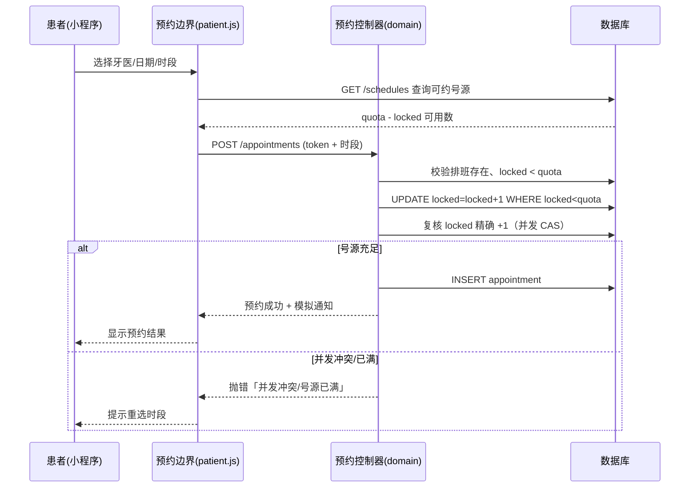
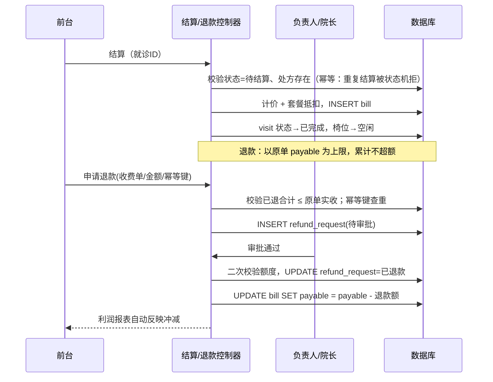
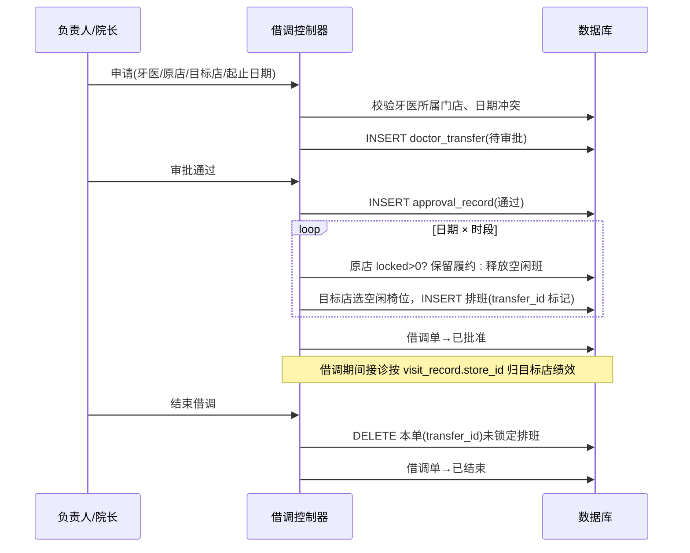

# 信义口腔 · UML 分析与设计补充（按课堂板书）

本文件对照板书要求补充三类建模产物：分析类（边界/控制/实体）、关键用例顺序图、类—表映射。与 `implementation-notes.md` 配套；业务数据均为模拟数据。

## 一、分析类（RUP 边界-控制-实体三分法）

系统边界内有三类分析类：边界类承接外部参与者交互，控制类编排用例流程，实体类对应领域持久化对象。

| 分析类 | 类型 | 职责 | 实现载体 |
|---|---|---|---|
| 患者小程序界面 | 边界 | 患者预约/取消/复诊/套餐查询入口 | `public/patient.html` + `public/js/patient.js` |
| 医生工作站界面 | 边界 | 接诊、病历、处方、治疗计划入口 | `public/dentist.html` + `public/js/dentist.js` |
| 管理工作站界面 | 边界 | 前台/院长/负责人/库管各岗位入口 | `public/admin.html` + `public/js/admin.js` |
| 工作人员登录界面 | 边界 | 统一登录、注册、改密入口 | `public/staff.html` + `public/js/staff.js` |
| 预约控制器 | 控制 | 校验号源、并发占号、取消释放 | `domain.ts: createAppointment / cancelAppointment` |
| 结算控制器 | 控制 | 计价、套餐抵扣、幂等与退款 | `domain.ts: settleBill`；`routes/refund.ts` |
| 借调控制器 | 控制 | 申请、审批、生成/清理排班 | `routes/transfer.ts` |
| 绩效控制器 | 控制 | 跨店归集、写入绩效明细 | `domain.ts: performanceReport` |
| 审批控制器 | 控制 | 注册/借调/退款任一方通过即生效 | `routes/auth.ts: recordApproval / approved` |
| 预约 | 实体 | 患者号源占用，状态机 | `appointment` 表 |
| 排班 | 实体 | 牙医可约时段、号源与椅位 | `dentist_schedule` 表 |
| 收费单 / 退款单 | 实体 | 收入与退款额度 | `bill` / `refund_request` 表 |
| 医生借调单 | 实体 | 跨店支援记录 | `doctor_transfer` 表 |
| 绩效 | 实体 | 牙医×门店×月归集 | `doctor_performance` 表 |
| 患者 / 牙医 / 员工 | 实体 | `person` 泛化子类 | `person` / `patient` / `dentist` / `staff_role` |

## 二、关键用例顺序图（Mermaid）

### 用例 UC-01 患者预约（含号源并发控制）

### 用例 UC-04 结算与退款（板书：支付幂等、退款额度/审批）

### 用例 UC-07 医生临时借调（含审批留痕与跨店绩效）

## 三、类—表映射（UML 类图要素落库）

| 类关系 | UML 语义 | 落库方式 |
|---|---|---|
| 患者/牙医/护士/前台/负责人/院长 继承 person | 泛化（Generalization） | `person` 父表主键作子类主键（patient.person_id 等） |
| 排班—椅位—门店 | 组合/关联 | 外键放非 1 方：`dentist_schedule.chair_id/store_id` |
| 处方—处方明细 | 组合（强拥有） | `prescription_item.prescription_id` 非空外键 |
| 套餐—项目 多对多 | 关联类 | `package_item(package_id, item_id)` 关联表 |
| 员工—角色 多对多 | 多对多 | `staff_role(person_id, role)` 联合主键 |
| 借调单—审批记录 | 关联 + 留痕 | `approval_record(biz_type, biz_id)` 多态关联 |
| 退款单—收费单 | 关联（额度约束） | `refund_request.bill_id` + 累计金额 ≤ `bill.payable` |

可见性约定：领域规则集中在 `domain.ts`（相当于控制类内部操作），路由层只做请求编排（边界），数据表字段对应实体属性；主键（PK）为 id，外键（FK）见上表，多重性以 1 / 0..1 / * 体现在空约束与关联表设计中。
